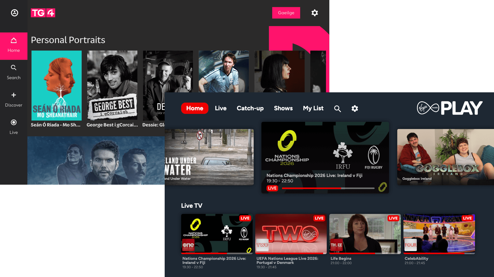

# Irish TV apps for old Samsung TVs

Patched Tizen 2.4 apps for **RTÉ Player**, **Virgin Media Play** and **TG4+**, tested on a Samsung UE40K5500.

<div align="center">
   
</div>

> [!IMPORTANT]
> Never mind the RTÉ Player broke overnight

| App | On demand | Live | Sign-in | Subtitles | Notes | Setup |
| --- | --- | --- | --- | --- | --- | --- |
| ~~RTÉ Player~~ | ~~✅~~ | ~~✅~~ | ~~✅*~~ | ~~✅~~ | ~~Very slow to load, occasional crashes loading boxsets~~ | ~~[README](apps/rte-player/README.md)~~ |
| Virgin Media Play | ✅ | ❗ | ✅ | ❌ | Live channels skipping, struggles with ad transitions | [README](apps/virgin-media-play/README.md) |
| TG4+ | ✅ | ❌ | ✅ | ❌ | Live DRM issues | [README](apps/tg4/README.md) |

Each app has its own `tv-app/config.xml`, icons, bundled frontend, and `maintenance` directory. RTÉ sign-in requires a small Cloudflare Worker.

Download the **unsigned WGTs** from this repository's releases, then import and sign them in Tizen Studio using a Samsung distributor certificate containing your TV's DUID.

## Repository layout

```
apps/
  rte-player/
    tv-app/              # ready-to-sign app, including config.xml
    worker/              # RTÉ login helper
    maintenance/         # build inputs, tools and tests
    README.md
    VERSION
  virgin-media-play/
    tv-app/              # ready-to-sign app, including config.xml
    maintenance/         # frozen frontend, native patches, tools and tests
    README.md
    VERSION
  tg4/
    tv-app/              # TG4+ catalogue, native VOD and Worldwide Live
    maintenance/         # frozen frontend, compatibility patches and tests
    README.md
    VERSION
scripts/package-release.py
docs/                    # current limitations and investigation handoff
```

See [release packaging](RELEASING.md), [current playback status](docs/STATUS.md), and each app's maintenance README. This repository includes third-party broadcaster/player frontend code needed by the packaged apps; their original notices and ownership remain applicable. The patches do not bypass DRM, sign-in or regional restrictions.

# AI disclaimer
I do not claim to have achieved anything here. I was just trying to get the players working on my parents' old TV without hooking up a laptop via HDMI. RTÉ Player was working but broke the next day. You get what you pay (or don't pay) for